<div align="center">

# AkiraCore

**Um app leve e de código aberto para controlar a iluminação, as teclas e as macros do teclado
AKIRA CORE (SK11A), da Adamantiun Gamer, no Windows.**

Uma alternativa ao software oficial: mesmos efeitos, interface em português e moderna,
e nada além do que você precisa para deixar o teclado do seu jeito.


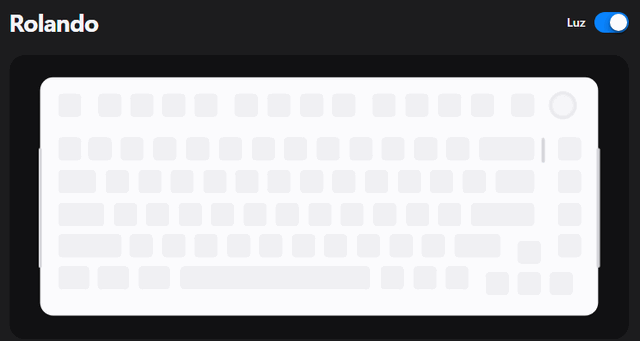

</div>

> Projeto independente, feito por um usuário do teclado. Não tem vínculo com a Adamantiun Gamer
> nem é suportado por ela.

## Por que usar

- **Simples de usar.** Escolha o efeito na lista, ajuste cor, brilho e velocidade, e pronto.
  Não existe botão "Aplicar": o teclado muda assim que você solta o controle.
- **Prévia ao vivo.** Um desenho do teclado mostra o efeito antes de você olhar para a mesa.
  Com a janela aberta, as teclas que você toca no AKIRA acendem na prévia nos efeitos que
  reagem ao toque. Só a posição da tecla vai para a tela; nada é guardado, e na bandeja ou
  minimizado o app não escuta o teclado (a única exceção é o modo Ao vivo com teclas "acender ao
  tocar", que precisa saber qual tecla acender). Pelo cabo, a prévia também pode mostrar as cores
  que os LEDs têm de verdade.
- **Funciona no cabo e no dongle 2.4G.** O app encontra o teclado sozinho e mostra por onde
  está conectado.
- **Fica na bandeja.** Liga e desliga a luz sem abrir a janela, e pode iniciar escondido junto
  com o Windows.
- **Lembra das suas escolhas.** A configuração fica salva no seu computador.
- **Acompanha o tema do Windows**, claro ou escuro.
- **Não usa a internet.** Nenhum dado sai do seu computador.
- **Código aberto.** Qualquer pessoa pode ler o que o app faz e o que ele envia ao teclado.

## O que dá para fazer

- **19 efeitos**, os mesmos do app oficial: Estático, Acender ao tocar, Apagar ao tocar, Brilhante,
  Queda, Colorido, Respiração, Espectro, Para fora, Rolagem, Rolando, Rotacionando, Explodir,
  Lançamento, Ondulações, Fluindo, Pulsante, Inclinação e Vaivém.
- **Cor fixa ou arco-íris**, nos efeitos que aceitam cor.
- **Brilho e velocidade** em 6 níveis, e **direção** nos efeitos que andam pelo teclado.
- **Desligar a luz** com um clique.
- **Guia das fitas de LED** dos cantos e da loading bar perto do knob, com os atalhos do teclado
  que controlam cada uma.
- **Trocar o que cada tecla faz**, na camada normal e na camada com `Fn` segurado: outra tecla, um
  atalho (Ctrl + C, Win + D…), multimídia, clique ou rolagem do mouse, uma macro, ou desativar.
- **Macros**: grave uma sequência de teclas (com as pausas reais ou fixas), acrescente cliques do
  mouse e escolha a tecla que dispara, tocando uma vez, N vezes, até apertar de novo ou enquanto
  segurar. Até 100 macros, guardadas no próprio teclado.
- **Cores por tecla**: pinte cada tecla com uma cor, guarde vários esquemas e troque entre eles.
- **Texto em macro**: digite um texto e o teclado passa a escrevê-lo sozinho, mesmo com o app
  fechado (no layout de teclado que o Windows usa, com acentos).
- **Perfis**: iluminação, teclas e configurações diferentes para jogo, trabalho etc., com troca
  pela barra lateral ou pela bandeja.
- **Backup**: exporte e importe tudo num arquivo; macros e esquemas de cores também podem ser
  exportados sozinhos.
- **Ao vivo** (com o app aberto, inclusive na bandeja): teclas animadas uma a uma (a "Luz
  personalizada" do oficial), **ritmo musical** com o som do PC, **cor da tela** nas teclas,
  **uso da CPU** e um **cronômetro** na fileira F. Pelo cabo, todos; pelo dongle, o ritmo musical.
- **Avisos**: o teclado pisca numa cor quando outro programa pede, por exemplo no fim de um build.
- **Perfil automático**: cada perfil pode ter uma lista de programas (jogos, editor…) e o app troca
  sozinho quando um deles vem para a frente. Junto com Cores por tecla, dá WASD aceso só no jogo.
- **Regras de luz**: apagar com o Windows bloqueado ou com a tela desligada, e um horário noturno que
  apaga ou deixa a luz no mínimo.
- **Atalhos globais**: ligar e desligar a luz, trocar de efeito, brilho, perfil e modo ao vivo de
  qualquer programa.
- **Teclas com ação do app**: abrir programa, arquivo ou site, digitar um texto (qualquer layout),
  calculadora, e-mail e outras teclas multimídia, bloquear, suspender ou desligar o PC.
- **Linha de comando** para scripts e automação: `AkiraCore.exe --efeito rolando --cor azul`.
- **Aviso de bateria fraca** no 2.4G, pela notificação do Windows.
- **Configurações do teclado**: bloquear a tecla Windows, Alt + F4 e Alt + Tab, modo do `Fn`
  (segurar ou alternar), tempo de suspensão e tempo de resposta das teclas.
- **Restaurar o padrão de fábrica**: iluminação, teclas, macros e configurações.
- **Bateria**: o nível aparece na barra lateral e na dica do ícone da bandeja quando o teclado está
  no dongle 2.4G (o teclado só informa por ele), e "carregando" quando o cabo está ligado no PC.

### Alguns dos efeitos

<table>
  <tr>
    <td align="center">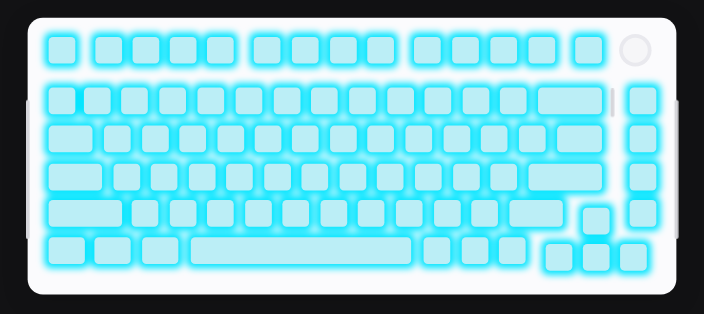<br>Estático</td>
    <td align="center">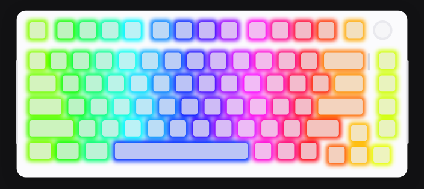<br>Rolando</td>
    <td align="center">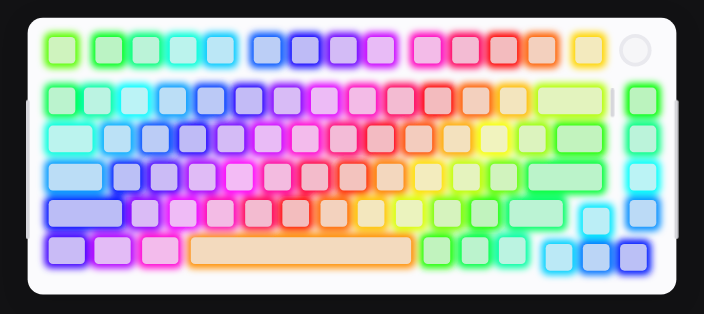<br>Fluindo</td>
    <td align="center">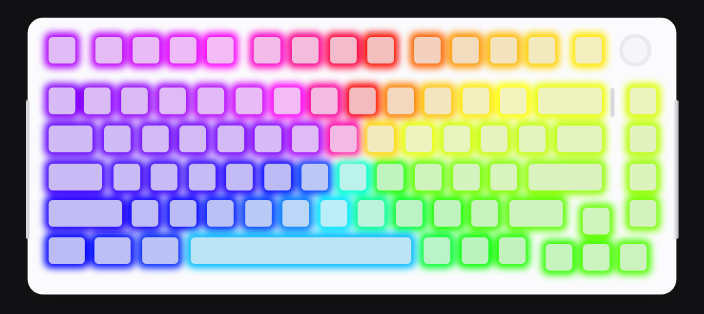<br>Rotacionando</td>
  </tr>
  <tr>
    <td align="center">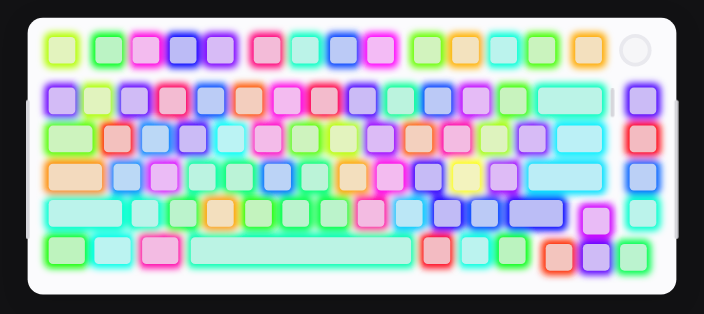<br>Colorido</td>
    <td align="center">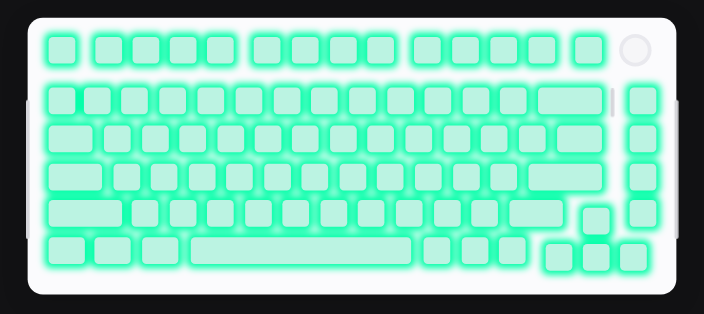<br>Espectro</td>
    <td align="center">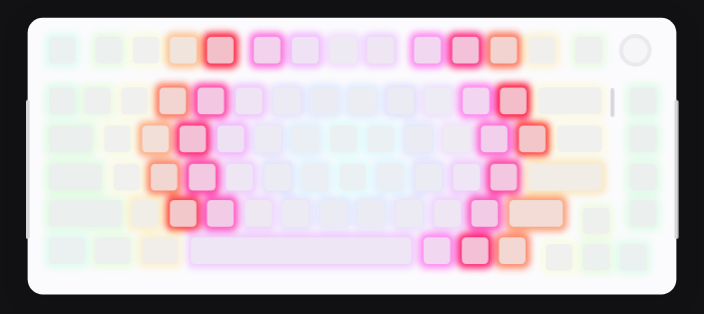<br>Para fora</td>
    <td align="center">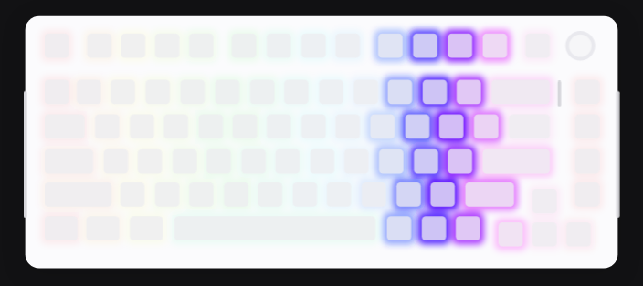<br>Vaivém</td>
  </tr>
</table>

As imagens vêm da prévia do próprio app; no teclado, a cor e o brilho reais dependem dos LEDs.

### Claro ou escuro, como o seu Windows

<table>
  <tr>
    <td>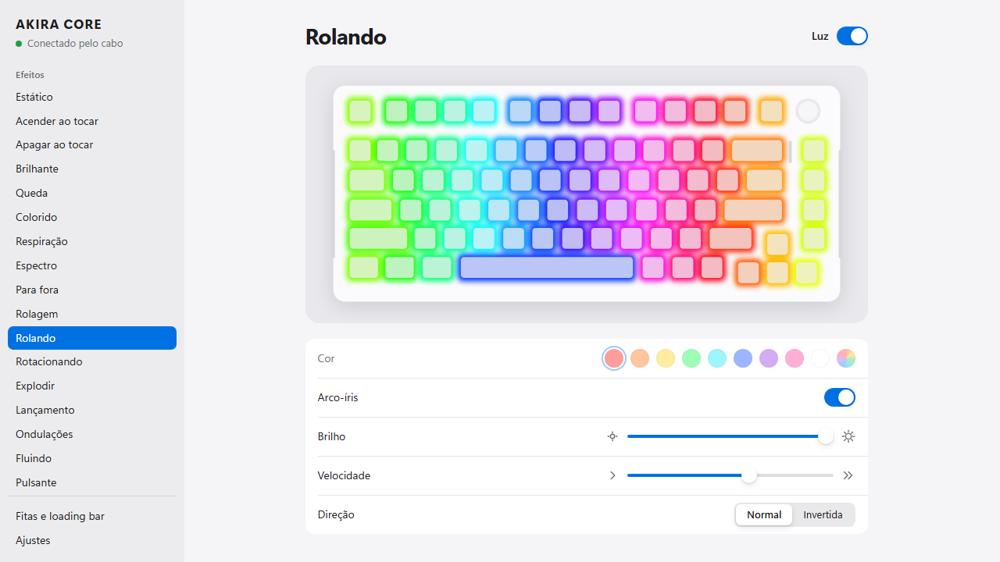</td>
    <td>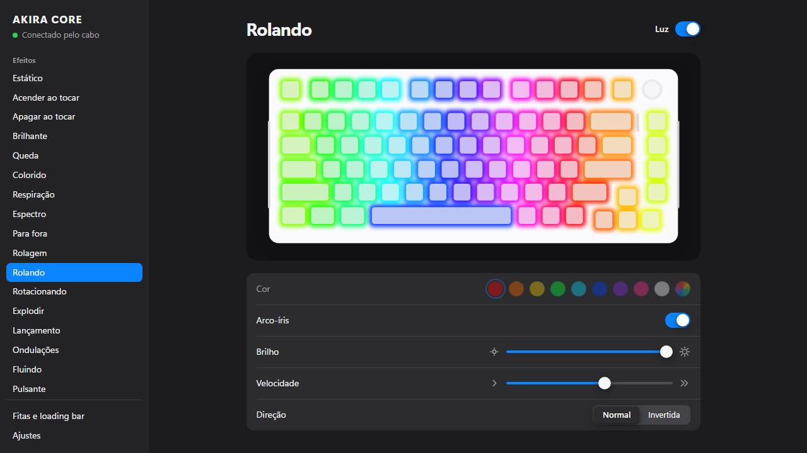</td>
  </tr>
</table>

### Fitas de LED e loading bar

As fitas dos cantos e a loading bar perto do knob mudam só pelos atalhos do teclado. O app mostra
onde fica cada uma e quais teclas usar.

<picture>
  <source media="(prefers-color-scheme: dark)" srcset="docs/img/fitas-escuro.png">
  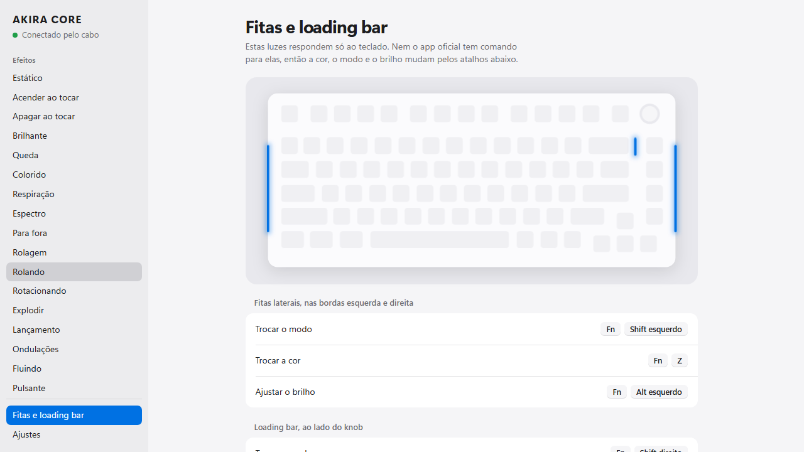
</picture>

## Comparado ao software oficial

| | AkiraCore | Software oficial |
|---|---|---|
| Efeitos de iluminação das teclas | ✅ Os 19 | ✅ Os 19 |
| Cabo USB e dongle 2.4G | ✅ | ✅ |
| Bluetooth | ❌ | ❌ |
| Bandeja do sistema | ✅ | ✅ |
| Código aberto | ✅ | ❌ |
| Remapeamento de teclas (normal e Fn) | ✅ | ✅ |
| Macros de teclado e mouse | ✅ | ✅ |
| Bloquear Win, Alt + F4, Alt + Tab; suspensão; tempo de resposta | ✅ | ✅ |
| Teclas que abrem programa, site ou digitam texto | ✅ (com o app aberto) | ✅ (com o app aberto) |
| Cor individual por tecla, com esquemas salvos | ✅ | ✅ |
| Luz personalizada animada por tecla | ✅ (só cabo) | ✅ (só cabo) |
| Ritmo musical | ✅ (cabo; dongle experimental) | ✅ |
| Cores reais dos LEDs na tela | ✅ (só cabo) | ✅ (só cabo) |
| Perfis | ✅ (com troca automática por programa) | ✅ |
| Texto gravado como macro no teclado (funciona com o app fechado) | ✅ | ❌ |
| Cor da tela, uso da CPU, cronômetro e avisos no teclado | ✅ (só cabo) | ❌ |
| Regras de luz (bloqueio, tela desligada, horário) | ✅ | ❌ |
| Atalhos globais e linha de comando | ✅ | ❌ |
| Aviso de bateria fraca e backup completo | ✅ | ❌ |
| Fitas dos cantos e loading bar | Só pelos atalhos | Só pelos atalhos |

Teclas, macros e configurações ficam gravadas no teclado e valem mesmo com o app fechado. Abrir
programa, abrir site e digitar texto dependem de um app rodando no computador, tanto no oficial
quanto aqui. No AkiraCore a tecla vira um atalho reservado (F13 a F24 com Ctrl, Alt e Shift) que o
app atende; com o app fechado ela não faz nada. Para um texto que funcione em qualquer PC, use
Macros › Inserir texto, que grava o texto no próprio teclado.

## Como instalar

**Requisitos:** Windows 10 ou 11 (64 bits) e o
[Microsoft Edge WebView2 Runtime](https://go.microsoft.com/fwlink/p/?LinkId=2124703), que já vem no
Windows 11 e no Windows 10 atualizado.

1. Baixe o `AkiraCore.exe` na página de [Releases](https://github.com/marcelosftelles/akira-core-sft/releases)
   (ou gere o seu, veja [Para desenvolvedores](#para-desenvolvedores)). Não precisa instalar nada:
   o executável roda sozinho.
2. **Feche o software oficial**, inclusive o ícone da bandeja. Os dois disputam o teclado e não
   devem ficar abertos ao mesmo tempo.
3. Abra o `AkiraCore.exe`. O status no canto superior mostra se o teclado foi encontrado.

Para iniciar com o Windows já escondido na bandeja, ligue Ajustes › Iniciar com o Windows. O app
grava o próprio caminho com `--hidden` em `HKCU\Software\Microsoft\Windows\CurrentVersion\Run`; se
mover o `.exe` de pasta, desligue e ligue de novo. A chave também respeita o que for desabilitado no
Gerenciador de Tarefas (aba Aplicativos de inicialização).

## Linha de comando

Para atalhos do Windows, scripts e pipelines. Com o app aberto, o pedido vai para ele; fechado, ele
abre na bandeja, executa e devolve a resposta (código de saída 0 quando deu certo).

```
AkiraCore.exe --efeito rolando --cor azul --brilho 3
AkiraCore.exe --perfil Jogo
AkiraCore.exe --desligar
AkiraCore.exe --ao-vivo musica
AkiraCore.exe --cronometro 25
AkiraCore.exe --aviso verde --vezes 5
AkiraCore.exe --status
AkiraCore.exe --ajuda
```

Os nomes também valem em inglês (`--effect rolling --color blue`). Com a pasta `tools` no PATH,
`dotnet akira` aceita os mesmos argumentos.

Exemplo num pipeline do Azure DevOps rodando num agente na própria máquina (com o `AkiraCore.exe`
no PATH):

```yaml
- script: AkiraCore.exe --aviso verde
  condition: succeeded()
- script: AkiraCore.exe --aviso vermelho --vezes 6
  condition: failed()
```

## Dúvidas comuns

**O app não encontra o teclado.**
Confira se o software oficial está fechado de verdade (inclusive na bandeja). No dongle, aperte uma
tecla para acordar o teclado. Em Ajustes › Diagnóstico o app lista o que o Windows vê do teclado.

**Como mudo as fitas dos cantos e a loading bar?**
Pelos atalhos do próprio teclado. Nem o app oficial tem comando para elas. Laterais: `Fn` + `Shift`
esquerdo (modo), `Fn` + `Z` (cor), `Fn` + `Alt` esquerdo (brilho). Loading bar: `Fn` + `Shift`
direito, `Fn` + `/?` e `Fn` + `Alt` direito.

**As cores saem trocadas (vermelho vira azul).**
Ligue Ajustes › Corrigir cores.

**O que o "Restaurar padrão de fábrica" faz?**
Volta a iluminação para o padrão (Rolando, arco-íris, brilho máximo) e **apaga as teclas mudadas,
as macros e as configurações do teclado**. No dongle, envia o mesmo reset do firmware que o app
oficial; no cabo, onde o oficial não tem esse comando, regrava os padrões na mesma ordem que ele.

**Mudei uma tecla e ela parou de funcionar. Como desfaço?**
Em Teclas, escolha a tecla e volte a ação para "Original", ou use Restaurar em "Todas as teclas".
Pelo mouse dá para fazer tudo isso mesmo que o teclado esteja trocado.

**O modo Ao vivo deixa o teclado mais lento ou gasta a memória dele?**
Não grava nada na memória do teclado: os quadros vão direto aos LEDs. Ao fechar o app ou desligar o
modo, a iluminação normal volta. O cabo recebe alguns quadros por segundo; o dongle, só as alturas
das barras do ritmo musical.

**Funciona por Bluetooth, no Linux ou no macOS?**
Não. O controle de iluminação só existe pelo cabo e pelo dongle, e o app é feito para Windows.

## É seguro?

O AkiraCore envia ao teclado só os comandos de iluminação, teclas, macros, configurações, reset de
fábrica, tempo real e ritmo musical, todos copiados do que o software oficial já envia. Ele **nunca** mexe no firmware e não manda comandos desconhecidos.
Mesmo assim, é um projeto não oficial: use por sua conta e risco.

Quer ver exatamente o que sai do computador? Ligue Ajustes › Simular envio: o app mostra os bytes
na tela sem mandar nada ao teclado.

<picture>
  <source media="(prefers-color-scheme: dark)" srcset="docs/img/ajustes-escuro.png">
  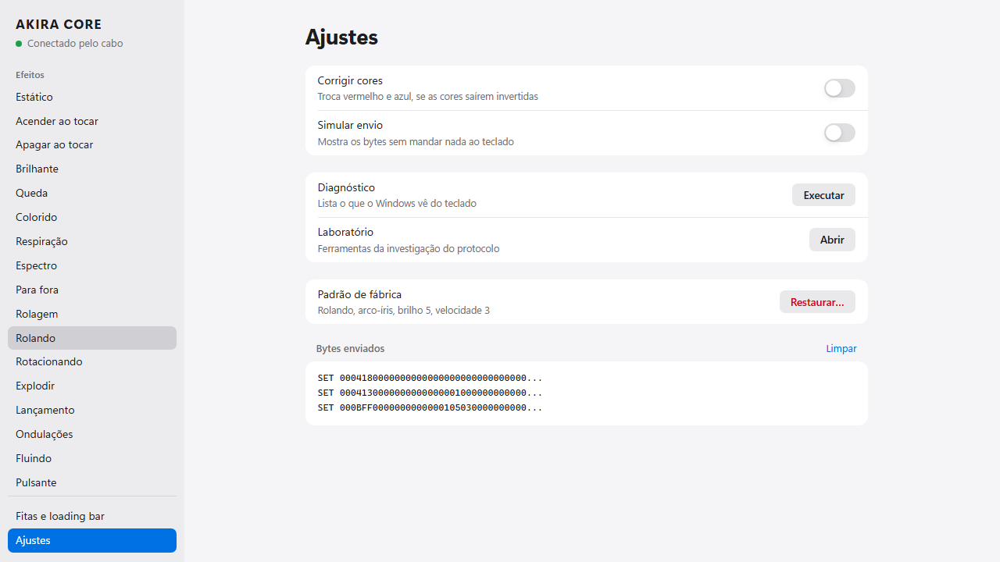
</picture>

## Status

Funcionando e testado em hardware: os efeitos das teclas pelo cabo e pelo dongle, cor, brilho,
velocidade, desligar a luz, bandeja e configuração salva.

Novo e ainda sem teste em hardware: teclas, macros e configurações do teclado. Os formatos foram
conferidos byte a byte no driver oficial (detalhes em [docs/protocolo.md](docs/protocolo.md)), mas
falta a confirmação no teclado de verdade, principalmente dos botões 4 e 5 do mouse.

Novíssimo, sem teste em hardware: o modo Ao vivo (tempo real pelo cabo e ritmo musical), o espelho
dos LEDs e a automação. O ritmo musical pelo dongle é experimental: o número de colunas e a escala
das barras ainda não foram confirmados e se ajustam no Laboratório.

Em investigação: se dá para controlar as fitas dos cantos e a loading bar pelo computador. As
evidências até agora indicam que elas respondem só ao firmware. O andamento está em
[docs/investigacao-fitas.md](docs/investigacao-fitas.md).

Encontrou um problema ou tem um AKIRA CORE para ajudar nos testes? Abra uma
[issue](https://github.com/marcelosftelles/akira-core-sft/issues).

## Para desenvolvedores

O protocolo foi reconstruído por engenharia reversa estática do driver oficial v1.0.0.0. Os detalhes
de cada canal, byte a byte, estão em [docs/protocolo.md](docs/protocolo.md).

| Projeto | Papel |
|---|---|
| `src/AkiraCore.Core` | Protocolo, efeitos, motor ao vivo (quadros, espectro), automação e regras. Sem dependência de Windows. |
| `src/AkiraCore.App` | Janela WinForms que hospeda a interface HTML (WebView2), bandeja, Laboratório, HID e Windows via P/Invoke (áudio WASAPI, tela, atalhos). |
| `tests/AkiraCore.Core.Tests` | Testes dos pacotes byte a byte (xUnit). |

Precisa do [.NET 8 SDK](https://dotnet.microsoft.com/download/dotnet/8.0).

```
dotnet test                              # roda em qualquer sistema
dotnet run --project src/AkiraCore.App   # só no Windows
```

Atalho: com a pasta `tools` no PATH do usuário, `dotnet akira` faz o mesmo `dotnet run` de qualquer
pasta (argumentos extras vão para o app, ex.: `dotnet akira --hidden`).

Gerar o executável único:

```
dotnet publish src/AkiraCore.App -c Release -r win-x64 --self-contained -p:PublishSingleFile=true
```

A interface é HTML/CSS/JS em `src/AkiraCore.App/Ui`, embutida no executável e servida em
`https://akira.ui` sem tocar na rede. Para revisar o visual sem Windows, sirva essa pasta
(`python -m http.server` dentro dela) e abra `index.html` num navegador. Sem WebView2 a página usa o
`dev-mock.js`, que aceita `?view=strips`, `?view=settings`, `?device=dongle|none`, `?off=1`,
`?effect=static&rainbow=0&color=%2300E5FF`, `?battery=15` e `?cable=1` (bateria na barra lateral), `?log=1`, `?dialog=1`, `?typing=1` (simula teclas
tocadas no AKIRA, para ver os efeitos reativos), `?view=keys` e `?view=macros`, `?macros=1` (já
vem com uma macro e duas teclas mudadas), `?select=55` (abre a tecla de índice 55 em Teclas),
`?view=colors` com `?colors=1` (esquema de cores em uso) ou `?colors=0` (nenhum esquema),
`?text=1` (abre "Inserir texto" em Macros), `?view=live&live=scene|music|screen|cpu|timer`
(modo ao vivo com quadros simulados), `?timer=1`, `?mirror=1` (espelho dos LEDs) e `?appkey=1`
(tecla com ação do app aberta em Teclas).

Em Ajustes há também o **Laboratório**, com as ferramentas usadas na investigação do protocolo.

## Aviso legal

AKIRA CORE e Adamantiun Gamer são marcas de seus respectivos donos. Este projeto não é afiliado,
endossado nem suportado por eles. O protocolo foi estudado só para permitir que o dono do teclado
controle a iluminação do próprio aparelho.
